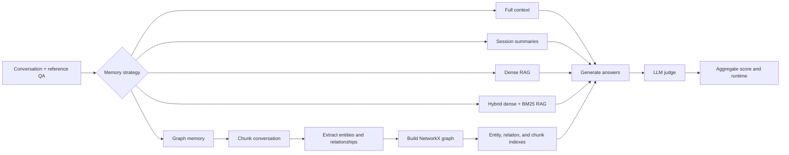

# Experiments on Agent Memory with Knowledge Graphs

> A research prototype for evaluating how different memory and retrieval strategies affect conversational question answering.

This project compares five ways to provide conversational context to a local language model:

1. **Full-context QA** — passes the complete conversation to the model.
2. **Summarised-context QA** — summarises each session before answering questions.
3. **Naive RAG** — retrieves semantically similar conversation chunks with FAISS.
4. **Hybrid RAG** — combines dense FAISS retrieval with sparse BM25 retrieval and entity metadata.
5. **LightRAG-style graph memory** — extracts entities and relationships into a NetworkX knowledge graph, indexes entities, relationships, and source chunks, and performs dual-level retrieval.

The workflows are orchestrated as typed **LangGraph** state graphs and evaluated with an LLM judge against reference answers from the LoCoMo-format conversation data included in `files/`.

## Why this project

Long conversations contain facts that are distributed across sessions and connected by people, events, and relationships. Flat chunk retrieval can miss those connections. This project investigates whether an explicit graph-memory layer can improve retrieval quality and make the evidence used by an agent more interpretable.

## Architecture



The graph-memory pipeline stores:

- entity nodes with merged descriptions and types;
- relationship edges with descriptions and source-chunk references;
- vector indexes for entities, relationships, and raw chunks;
- a GraphML export in `knowledge_graph.graphml` and extracted elements in `outputs/graph_elements.json`.

Retrieval combines low-level entity matching, one-hop graph expansion, high-level relationship matching, and direct chunk similarity as a fallback.

## Checked-in experiment snapshot

The repository contains logs from one sample conversation with **19 sessions and 199 questions**. Scores below are the average LLM-judge score on a 0–1 scale; runtime is the value printed by the corresponding log.

| Strategy | Judge score | Runtime | Log |
| --- | ---: | ---: | --- |
| Full context | 0.46 | 20.36 min | [`output_0.txt`](logs/testing/output_0.txt) |
| Summarised context | 0.38 | 8.73 min | [`output_1.txt`](logs/testing/output_1.txt) |
| Naive RAG | 0.40 | 2.07 min | [`output_2.txt`](logs/testing/output_2.txt) |
| Hybrid RAG | 0.42 | 3.98 min | [`output_3.txt`](logs/testing/output_3.txt) |
| LightRAG-style graph memory | 0.38 | 27.34 min | [`output_4.txt`](logs/testing/output_4.txt) |

The snapshot is an engineering experiment, not a controlled benchmark: the graph-memory run uses a different local model than the other four runs, and the logs represent a single conversation sample. These numbers should therefore be used as a starting point for further experimentation, not as a general ranking of the methods.

The graph run built **191 entities, 223 relationships, and 163 chunks** before dual-level retrieval. The other retrieval pipelines use 211 chunks because their splitter configuration differs.

## Repository structure

| Path | Purpose |
| --- | --- |
| `graph_construction.py` | Main LangGraph router and experiment entry point |
| `full_context_qa.py` | Full-context baseline |
| `summarise_qa.py` | Session summarisation baseline |
| `rag_qa.py` | Dense FAISS RAG baseline |
| `hybrid_rag_qa.py` | Dense + BM25 hybrid retrieval |
| `lightrag_qa.py` | Graph extraction, indexing, and dual-level retrieval |
| `utils.py` | LoCoMo-style conversation and QA loading |
| `models.py` | Local Hugging Face model and generation pipeline setup |
| `all_prompts.py`, `lightrag_prompts.py` | Generation, judging, and graph-extraction prompts |
| `files/` | Input conversations |
| `logs/` | Checked-in experiment output |
| `images/` | Pipeline and graph visualisations |
| `knowledge_graph.graphml` | Exported knowledge graph |

## Running an experiment

The code is designed for a machine with local Hugging Face model and embedding weights. It sets Transformers and Hugging Face Hub to offline mode, so model files must already exist locally.

```bash
git clone https://github.com/Suraj-000/Experiments-on-agent-memory-using-knowledge-graphs.git
cd Experiments-on-agent-memory-using-knowledge-graphs

python -m venv .venv
source .venv/bin/activate
pip install torch transformers accelerate numpy tqdm networkx \
  langgraph langchain-core langchain-community langchain-classic \
  langchain-huggingface langchain-text-splitters faiss-cpu \
  rank-bm25 sentence-transformers pydantic
```

Run one strategy against the sample conversation:

```bash
python graph_construction.py --task 0  # full context
python graph_construction.py --task 1  # summarised context
python graph_construction.py --task 2  # naive RAG
python graph_construction.py --task 3  # hybrid RAG
python graph_construction.py --task 4  # graph memory
```

Outputs are written to `logs/testing/output_<task>.txt`. The default entry point loads a local model configured in `graph_construction.py`; update that configuration and the local embedding model path for your environment before running. The CLI currently exposes `--model_name`, but the main entry point selects its model from the `all_models` list in the script.

## Evaluation design

Each strategy follows the same high-level evaluation loop:

1. Load a conversation and its reference questions.
2. Build the strategy-specific memory or retrieval index.
3. Generate one answer per question.
4. Ask a judge model to score each answer against the reference answer.
5. Report the sum, average score, and execution time.

This design makes the retrieval strategies easy to compare while keeping the QA and judging prompts shared where appropriate. For a stronger study, run every strategy across all conversations, use the same answer and judge models, record token and GPU-memory costs, and aggregate confidence intervals.

## Limitations and next steps

- There is no dependency lockfile or automated test suite yet.
- Model and embedding weights are expected to be available locally.
- Some paths in the current scripts are machine-specific; portability requires moving them into configuration.
- `results_summarise.py` contains a hard-coded log path and requires a separate local model, so the checked-in log table above is the authoritative snapshot.
- The current evaluation uses an LLM judge and should be complemented with exact, human, or rubric-based evaluation.

## License

No license has been declared yet. Add a license before distributing or reusing this project.
