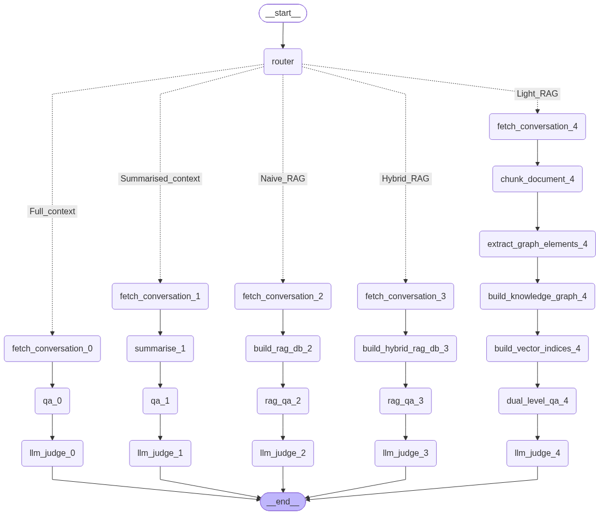
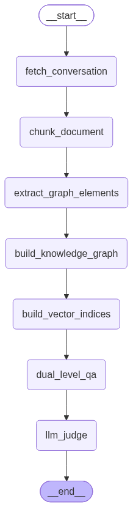
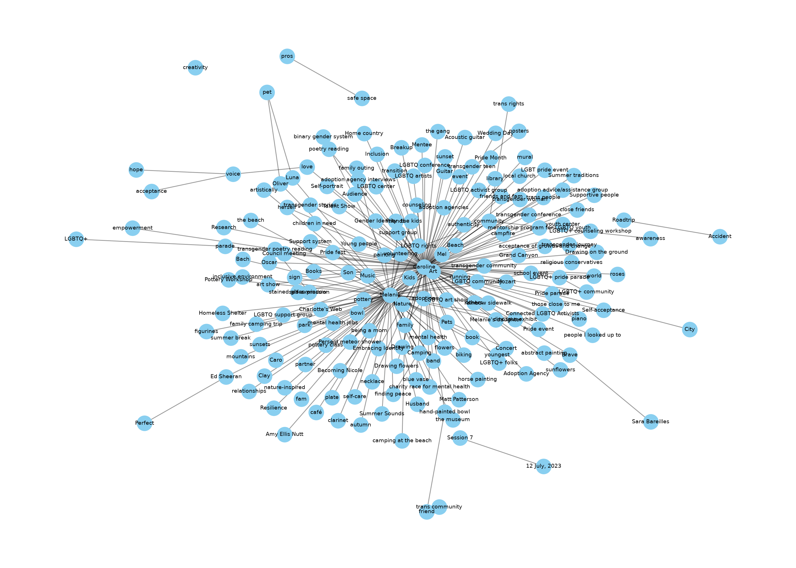
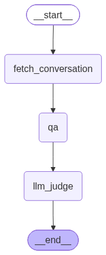
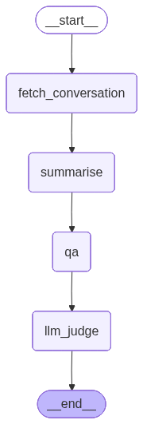
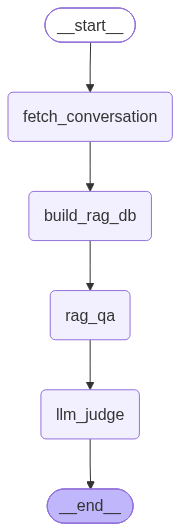
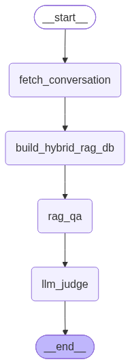

- **Experiments on agent memory using knowledge graphs** — concise, reproducible comparisons of memory strategies for conversational QA agents.
- **Goal:** evaluate how graph-structured memory (LightRAG / HybridRAG) affects retrieval quality, answer accuracy, and interpretability compared to baseline RAG and full-context LLM QA.
- **Core approaches tested:** **Full-context**, **Summarised-context**, **Naive RAG**, **Hybrid RAG**, **LightRAG (graph-based dual-level retrieval)**.
- **Why it matters:** graph-based memory captures explicit entities and relationships, enabling **richer context retrieval**, **explainable evidence paths**, and potential improvements in long-range conversational QA where flat chunking fails.
- **Experiment pipeline (visual):**
  - 
  - 
- **Knowledge-graph example (visual):**
  - 
- **Sample QA experiment flows (visual):**
  - 
  - 
  - 
  - 
- **What was measured:** **LLM judge scores**, per-question final scores, and **execution time** (logs are aggregated by results_summarise.py).
- **Results & analysis (how to get them):**
  - **Logs are collected** under the experiment logs directory; run the included aggregation to extract reported accuracies and execution times.
  - **Script:** `results_summarise.py` — extracts every experiment/model and returns final reported accuracy and execution time from logs.
- **Observed benefits (qualitative):**
  - **Graph-based retrieval** often surfaces more focused, entity-centered evidence for questions.
  - **Dual-level retrieval** (entities + relations) reduces retrieval misses by combining fine-grained and thematic signals.
  - **Merged descriptions** from multiple chunks improve node/edge summaries and reduce noisy evidence.
- **Practical significance:** this work shows how lightweight graph memory layers can make agent answers more **traceable**, **context-aware**, and potentially more **robust on long conversations** where naive chunking loses structure.
- **Code highlights:** modular nodes for each method are implemented and wired via a state graph (see `graph_construction.py`, `lightrag_qa.py`, `hybrid_rag_qa.py`, `rag_qa.py`, `full_context_qa.py`, `summarise_qa.py`).
- **Reproduce an experiment (short):**
  - `python graph_construction.py --task <0|1|2|3|4>`  (0=Full,1=Summarised,2=Naive RAG,3=Hybrid,4=LightRAG)
  - Check generated logs in `logs/<model>/` and run `python results_summarise.py` to aggregate results.
- **Where to look next:** inspect `images/` for visual outputs, `knowledge_graph.graphml` for graph exports, and `outputs/` for intermediate artifacts.
- **If you want:** I can commit this README.md to the repo, or produce a one-line abstract or a short methods table — tell me which you prefer.
